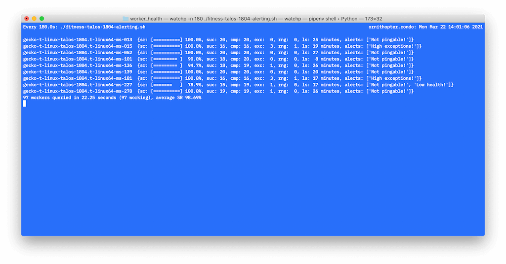

# worker health tools

Tools to ensure Taskcluster workers are not idle and performing well (success rate).

## Pool Classifier moved

Pool Classifier now lives in its own repository:

```text
git@github.com:mozilla-platform-ops/pool-classifier.git
```

Use that repository for Pool Classifier development, deployment, issues, and
operator documentation. Do not deploy Pool Classifier from this repository.

## TODO

- move code into https://github.com/mozilla-platform-ops/relops-infra

## setup

### Python and related

For all tools, run in the pipenv.

```
# one-time setup
# install pipenv
pipenv install

# for every use
pipenv shell
# run command
```

### Taskcluster credentials

Many of the tools make calls against Taskcluster. We use a token stored in ~/.tc_token.

```bash
{
    "clientId": "mozilla-auth0/ad|Mozilla-LDAP|aerickson/quarantine-workers",
    "accessToken": "REDACTED"
}
```

You can create a client token at https://firefox-ci-tc.services.mozilla.com/auth/clients.

Make the expiration 100 years or similar. The only scope currently required is:

```bash
queue:quarantine-worker:*
```

## overview

### create_tc_task.py

Submit test tasks to a Taskcluster worker queue. By default, each task sleeps
for 60 seconds and prints an increasing counter once per second in its live log.

For two tasks that each sleep for five minutes with the counter:

```bash
pipenv run python ./create_tc_task.py \
  -q releng-hardware/gecko-t-linux-talos-2404-tc-v115 \
  -c 2 --command-timeout 310
```

The default loop runs for `--command-timeout` minus a 10-second buffer, so
`310` gives 300 seconds of sleep. `--bash-command` or `--script-file` replaces
that loop; for example, `--bash-command 'sleep 300' --command-timeout 330`
sleeps silently for five minutes with a 30-second timeout buffer.

Add `--wait` to monitor task status in the CLI; the per-second counter appears
in the task's live log. Use `pipenv run python ./create_tc_task.py --help` for
all options.

With `--wait`, an interactive terminal shows a live table with task status and
worker names, followed by results and a summary. Task IDs link to Taskcluster
in terminals that support links. Redirected table output shows the final table
and summary.

Use `--wait --output log` for status updates in logs, or
`--wait --output json` for a JSON object containing a `tasks` list with each
task's ID, state, result, worker ID, and URL. JSON results go to stdout;
submission progress and diagnostics go to stderr. Wait mode exits nonzero if
any submission fails or any task finishes as failed or exception.

### replay_tc_task.py

Clone a completed real job under a fresh task ID. The destination defaults to
the source pool; `--queue` selects another compatible pool. Both task/run URLs
and worker pool URLs are accepted as well as IDs.

Preview the example Browsertime Google Docs job on the `tc-v115` pool:

```bash
pipenv run python ./replay_tc_task.py ICHaZTMDTx2YY-fM3qlVXA \
  --queue releng-hardware/gecko-t-linux-talos-2404-tc-v115 --dry-run
```

`--dry-run` prints a `DRY RUN` banner to stderr, checks the source and reused
inputs, then prints a JSON plan with `"dry_run": true`, `"tasks_submitted": 0`,
and the full proposed task definitions. The listed task IDs have not been
submitted. To submit two copies with live task status:

```bash
pipenv run python ./replay_tc_task.py ICHaZTMDTx2YY-fM3qlVXA \
  --queue releng-hardware/gecko-t-linux-talos-2404-tc-v115 --count 2 --wait
```

The source must have state `completed`. Its command, environment, mounts,
runtime limit, scopes, and dependency references are preserved. Dependencies
are checked for usable states; explicit artifact references in mounts, task
images, `MOZ_FETCHES`, and Firefox CI artifact URLs are checked for existence,
expiration, and error artifacts. This does not check external downloads,
artifacts discovered at runtime, or guarantee that inputs remain available
until execution.

Clones share a new diagnostic task group with scheduler `-` and project `none`.
Original routes, tags, and reporting metadata are removed, so these jobs do
not report into the source Treeherder push. They use lowest priority, zero
queue retries, a 24-hour deadline, and seven-day task/output artifact retention.
The operator becomes the task owner, and the source task is linked in the
description and recorded in `extra.replay`.

Revision environment variables such as `GECKO_HEAD_REV` and
`MOZ_SOURCE_CHANGESET` remain intact so the workload uses the original source
revision. They do not attach the replay to a Treeherder push: the standard
[Treeherder ingestion handler](https://github.com/mozilla/treeherder/blob/master/treeherder/etl/taskcluster_pulse/handler.py)
requires a `tc-treeherder` route and `extra.treeherder`, both of which are absent
from the clone. Logs and artifacts can still mention the original revision.

Cross-pool replay preserves the payload and scopes without translating them;
the destination needs a compatible worker implementation, OS, tools, features,
and permissions. Submission uses `~/.tc_token` and requires the source payload's
scopes plus permission to create tasks on the destination with scheduler `-`
and project `none`. A public preview can run without a token. Selecting a task
from a particular worker does not target that same host. Pool-history discovery
is not implemented yet.

`--wait --output log` and `--wait --output json` use the same monitoring formats
as `create_tc_task.py`. Without `--wait`, JSON output lists submitted task IDs
and URLs. Diagnostics go to stderr. A run URL selects the task definition;
artifact references without an explicit run ID still resolve to the latest
dependency run.

### fitness.py

Shows each worker's success rate and various concerning conditions like, consecutive failures, lack of work.

Provides a report on a provisioner and worker-type.

Not specific to Bitbar (works on all taskcluster provisioners).



```
./fitness_check.py -h

# to report on all worker types under a provisioner
./fitness_check.py -p PROVISIONER
# for a specific worker-type in the provisioner
./fitness_check.py -p PROVISIONER WORKER-TYPE
```

### missing_workers

For static hardware pools (like moonshots, macs, and bitbar), alert if a worker hasn't worked in more than a day (they disappear from TC output in 24 hours).

If a queue doesn't have work, we can't verify they're functioning (via the currently used method - TC doesn't show static worker status unless working (I think) in https://firefox-ci-tc.services.mozilla.com/docs/reference/platform/queue/api#listWorkers).

```bash
./missing_workers.py -h
```

### safe_runner

Runs a command on a set of hosts once each has been quarantined and no jobs are running.

Features:
- integrates with Taskcluster API to quarantine, check no jobs are running, and lift quarantine
- ability to resume from a state file
- OS X speech support for updates
- pre-quarantine feature (quarantines several hosts) so there's less waiting for jobs to finish
- command output is logged to file

Potential issues:
- If ssh is giving you issues with Bolt, append '--native-ssh' to your Bolt command.

```bash
# for options
./safe_runner.py -h

# basic usage
./safe_runner.py -r sr_state_dir_xyz
# edit config and set options
vi sr_state_dir_xyz/runner_state.toml
./safe_runner.py -r sr_state_dir_xyz

# resume from existing state file and set options
./safe_runner.py -r sr_state_dir_xyz -t -R -P 11
```

### unsafe_runner

Similar to safe_runner, but doesn't deal with any quarantine stuff.

### quarantine_tool

Lists quarantined hosts, quarantines, lifts quarantine, and lists all workers in a workerType.

```bash
# show quarantined
./quarantine_tool.py proj-autophone gecko-t-bitbar-gw-unit-p2 show

# show all workers
./quarantine_tool.py proj-autophone gecko-t-bitbar-gw-unit-p2 show-all

./quarantine_tool.py proj-autophone gecko-t-bitbar-gw-unit-p2 quarantine pixel2-01
./quarantine_tool.py proj-autophone gecko-t-bitbar-gw-unit-p2 lift pixel2-01
```

### slack_alert

Sends scheduled slack message about problem hosts.

```
./slack_alert.py -h
```

### influx_logger

Logs worker health metrics to influx.

```
./influx_logger.py -h
```
